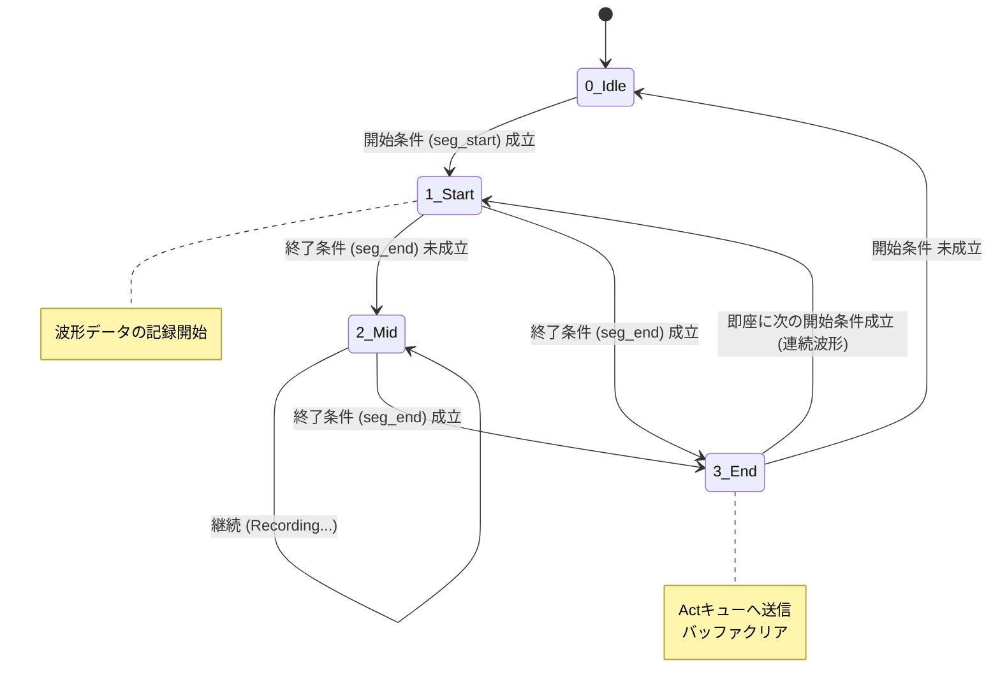

# Tri-On-Edge 波形切出しロジックと設定ガイド

- Ver: 01.f.20261005
- By: IWATA, Y.'s Agent AI
- Mod: 判定の閾値キーを実装どおり `border` に修正（従来の `threshold` は読まれず判定が成立しなかった）。duration の説明を実装に合わせて修正

---

対象読者
- ユーザ（現場担当者・運用担当者）
- 開発者

---

上位文書
- Tri-On-Edge Stream システム全体解説

---

## 1. 概要：ストリームから「意味」を切出す

　Stream Core は、絶え間なく流れてくるデータ（ストリーム）を常時監視し、特定の条件を満たした区間だけを「波形（セグメント）」として切出す。

### ステートマシン（状態遷移）の概念
波形切出しは、内部的に以下の4つの状態（Status）を遷移することで実現する。



 * 0: Idle (待機): 何も記録していない状態。「開始条件」のみを監視
 * 1: Start (開始): 波形の始まり。記録を開始します。「終了条件」の監視を開始
 * 2: Mid (記録中): 波形の途中。記録を継続しつつ、「終了条件」を監視
 * 3: End (終了): 波形の終わり。ここまでのデータを後工程（Act）へ送り、バッファをクリア


## 2. 設定ファイルの基本構造

`trigger_setting_01.json` の `monitor` セクションに記述する。

```json
"monitor": {
    "seg_start": {
        "stages": [
            {
                "op": "AND",
                "checks": [ ... ]
            }
        ]
    },
    "seg_end": {
        "stages": [ ... ]
    }
}
```

セグメント長の上限（`seg_max_rows` / `seg_max_sec`）も同じ `monitor` セクションに記述する（「5. セグメント長の上限（強制クローズ）」参照）。

### 利用可能な判定メソッド

閾値は各チェックの `border` キーに記述する（`"threshold"` などそれ以外のキー名は読まれず、閾値なし（None）として扱われるため判定が成立しない）。

| メソッド名 | 説明 | border |
|---|---|---|
| upto | 前回値より上昇し、かつ閾値以上になった | 数値（下限）、または範囲 `{"lower": 下限, "upper": 上限}`（前回値が範囲外→今回値が範囲内で成立） |
| downto | 前回値より下降し、かつ閾値以下になった | 数値（上限）、または範囲 `{"lower": 下限, "upper": 上限}`（同上） |
| change | 前回値と値が変わった | null |
| equal | 値が閾値と等しい | 値 |
| not_equal | 値が閾値と異なる | 値 |
| diff | 前回値との差分（絶対値）が閾値以上 | 数値 |
| duration | そのステージがアクティブな間（前段のステージが成立してから）に、指定回数評価された（＝指定レコード数を受信した） | 回数（int） |
| duration_time | ステージ開始から指定秒数が経過した | 秒数（float） |

## 3. 設定パターン集

### パターンA：シンプルな閾値

シナリオ：「電流値（列番号5）が 10.0 を超えたら開始し、5.0 を下回ったら終了する」

```json
"monitor": {
    "seg_start": {
        "stages": [{
            "op": "AND",
            "checks": [{ "method": "upto", "target_loc": 5, "border": 10.0 }]
        }]
    },
    "seg_end": {
        "stages": [{
            "op": "AND",
            "checks": [{ "method": "downto", "target_loc": 5, "border": 5.0 }]
        }]
    }
}
```

### パターンB：状態変化

シナリオ：「設備ステータス（列番号0）が変化したら開始、次の変化で終了（1変化＝1波形）」

```json
"monitor": {
    "seg_start": {
        "stages": [{
            "checks": [{ "method": "change", "target_loc": 0, "border": null }]
        }]
    },
    "seg_end": {
        "stages": [{
            "checks": [{ "method": "change", "target_loc": 0, "border": null }]
        }]
    }
}
```

## 4. 高度な機能：Multi-Stage Logic（段階的判定）

　複数のステージを定義すると、上から順番（直列）にクリアして初めて開始・終了と判定される。前のステージがクリアされると、その状態が保持され、次のステージの評価が始まる。

### パターンC：チャタリング除去（ノイズフィルタ）

シナリオ：「センサー（列番号3）が ON(1) になり、その状態が 2.0秒以上続いたら開始とみなす」

```json
"seg_start": {
    "stages": [
        {
            "##": "Stage 1: まずONになったことを検知",
            "op": "AND",
            "checks": [{ "method": "equal", "target_loc": 3, "border": 1 }]
        },
        {
            "##": "Stage 2: その後、2秒間待機",
            "op": "AND",
            "checks": [{ "method": "duration_time", "target_loc": 0, "border": 2.0 }]
        }
    ]
}
```

### パターンD：複合条件（OR）

シナリオ：「異常コード（列番号2）が 'E001' または 'E002' が出たら即座に終了」

```json
"seg_end": {
    "stages": [{
        "op": "OR",
        "checks": [
            { "method": "equal", "target_loc": 2, "border": "E001" },
            { "method": "equal", "target_loc": 2, "border": "E002" }
        ]
    }]
}
```

まとめ
| 難易度 | 用途 | 構成 |
|---|---|---|
| Basic | 単純な閾値超え | stages は1つ。checks も1つ。 |
| Parallel | 複数のトリガー条件（OR） | stages は1つ。op="OR" で checks を複数列挙。 |
| Sequential | 時間差判定・手順順守確認 | stages を複数定義（Stage1 → Stage2 → ...）。 |

まずはパターンAで動作確認し、ノイズが問題になったらパターンCを使うのを推奨


## 5. セグメント長の上限（強制クローズ）

終了条件が成立しないまま入力が続くと、セグメントのバッファが際限なく伸び、エッジPCのメモリを圧迫する。
これを防ぐため、セグメントの長さに上限を設けられる（`monitor` セクションに記述）。

```json
"monitor": {
    "seg_start": { ... },
    "seg_end":   { ... },
    "seg_max_rows": 100000,
    "seg_max_sec" : 600
}
```

| キー | 説明 | 既定値 |
|---|---|---|
| seg_max_rows | セグメントの最大行数。開始点を含む行数がこの値に達したら強制クローズする | 0（無制限） |
| seg_max_sec | セグメントの最大秒数。開始点の受信時刻から、この秒数以上経過したレコードで強制クローズする | 0（無制限） |

- 両方を設定した場合は、**先に達した方**で強制クローズする。0 にした方は無効
- 強制クローズ時は、その時点のバッファを1つのセグメントとして後工程（Act）へ送る（終点の扱いと同じ）
- 強制クローズ後は 0: Idle（待機）に戻り、次のレコードから開始条件を評価し直す
  - 開始条件が状態型（例：`equal`）でまだ成立していれば、すぐに次のセグメントが始まる（上限ごとに分割されて流れる）
  - 開始条件が変化型（例：`change`）なら、次の変化を待つ
- 強制クローズはログファイルに WARNING（`reason=rows` / `reason=sec`、行数・秒数付き）として1行残り、
  定期集計 `[SEG SUMMARY]` の `forced=件数`、運用系メトリクス `total_forced_segments` にも計上される
- 秒数の判定はレコード受信時に行う（入力が途切れている間は判定しないが、その間バッファも増えない）
- 強制クローズしたセグメントには終点行（終了条件が成立した行）が無いため、`CUT_LAST_ROW = True` の Act でも
  Stream Core は最終行を除外しない（全行が後工程へ届く。「6. 終点行の扱い」参照）

## 6. 終点行の扱い（CUT_LAST_ROW）

セグメントは「開始点から、終了条件が成立した行（終点行）まで」として切り出される。
終点行は、使い方によって中身が異なる。

| 使い方 | 終点行の中身 |
|---|---|
| LOT 変化（`change`） | 次の LOT の先頭行（終点＝開始点の場合は次のセグメントの先頭行にもなる） |
| ファイル監視（find_file） | セグメント区切りのダミー行（`"____"`） |
| PLC の起動信号が落ちる構成 | 信号が 0 になった実データの行 |

終点行を後工程（Act）で使うかどうかは、Act Trigger 関数の属性 `CUT_LAST_ROW` で宣言する。

| CUT_LAST_ROW | Stream Core の動作 |
|---|---|
| `True` | 終点行を除外してから Act へ渡す（STQ の場合は除外してから登録する） |
| `False` | 終点行を含めて全行を渡す（扱いは Act 側で判断する。例: rdb 系は `exclude_last_row` 設定で判断） |
| 属性なし | `False` と同じ（全行を渡す） |

- 意図を示すため、リポジトリ内の Act Trigger は `True` / `False` のどちらも明記している
- 上限（`seg_max_rows` / `seg_max_sec`）による強制クローズのセグメントは、終点行が無いため除外しない
- `seg_range`（検出ログの区間表示）は終点行を含む `[開始index, 終点index]` で表示する
- 起動時のログに `cut_last_row=True/False (declared / default: not declared)` が出力される

以上