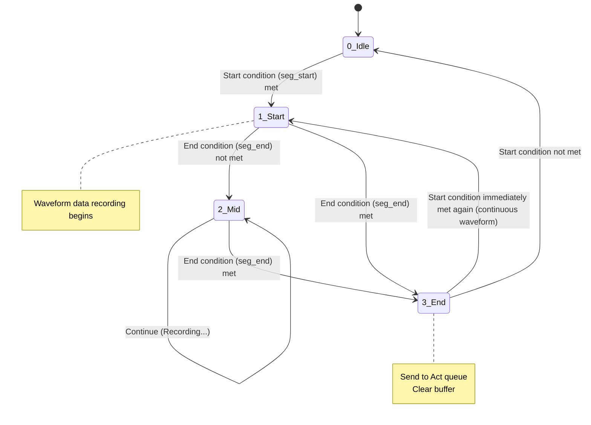

# Tri-On-Edge Waveform Cut-Out Logic and Configuration Guide

- Ver: 01.d.20261005
- By: IWATA, Y.'s Agent AI
- Mod: Synced with the Japanese edition 01.f. Corrected the threshold key to `border` as implemented (the former `threshold` key was never read, so judgments never held), corrected the description of duration, and added "5. Segment Length Limit (Forced Close)" and "6. Handling of the End Row (CUT_LAST_ROW)"

---

Target Audience
- Users (site operators / maintenance staff)
- Developers

---

Parent Document
- Tri-On-Edge Stream: System Description

---

## 1. Overview: Cutting "Meaning" Out of a Stream

　Stream Core continuously monitors the never-ending flow of incoming data (the stream) and cuts out only the intervals that satisfy specific conditions as a "waveform (segment)."

### The State-Machine Concept

Waveform cut-out is internally realized by transitioning through the following four states (Status).



 * 0: Idle (waiting): nothing is being recorded. Only the "start condition" is monitored.
 * 1: Start: the beginning of a waveform. Recording begins, and monitoring of the "end condition" starts.
 * 2: Mid (recording): the middle of a waveform. Recording continues while the "end condition" is monitored.
 * 3: End: the end of a waveform. Data accumulated so far is sent to the downstream process (Act), and the buffer is cleared.


## 2. Basic Structure of the Configuration File

Written in the `monitor` section of `trigger_setting_01.json`.

```json
"monitor": {
    "seg_start": {
        "stages": [
            {
                "op": "AND",
                "checks": [ ... ]
            }
        ]
    },
    "seg_end": {
        "stages": [ ... ]
    }
}
```

The segment length limits (`seg_max_rows` / `seg_max_sec`) are also written in the same `monitor` section (see "5. Segment Length Limit (Forced Close)").

### Available Judgment Methods

The threshold is written in the `border` key of each check. Any other key name, such as `"threshold"`, is not read; the threshold is treated as absent (None), so the judgment never holds.

| Method | Description | border |
|---|---|---|
| upto | Rose from the previous value and reached or exceeded the threshold | Numeric (lower bound), or a range `{"lower": lower, "upper": upper}` (holds when the previous value is outside the range and the current value is inside it) |
| downto | Fell from the previous value and reached or dropped below the threshold | Numeric (upper bound), or a range `{"lower": lower, "upper": upper}` (same as above) |
| change | The value changed from the previous value | null |
| equal | The value equals the threshold | value |
| not_equal | The value differs from the threshold | value |
| diff | The absolute difference from the previous value is at least the threshold | numeric |
| duration | Evaluated the specified number of times while the stage is active (after the preceding stage held), i.e., the specified number of records were received | count (int) |
| duration_time | The specified number of seconds has elapsed since the stage began | seconds (float) |

## 3. Configuration Pattern Collection

### Pattern A: Simple Threshold

Scenario: "Start when the current value (column 5) exceeds 10.0, and end when it drops below 5.0."

```json
"monitor": {
    "seg_start": {
        "stages": [{
            "op": "AND",
            "checks": [{ "method": "upto", "target_loc": 5, "border": 10.0 }]
        }]
    },
    "seg_end": {
        "stages": [{
            "op": "AND",
            "checks": [{ "method": "downto", "target_loc": 5, "border": 5.0 }]
        }]
    }
}
```

### Pattern B: State Change

Scenario: "Start when the equipment status (column 0) changes, and end on the next change (1 change = 1 waveform)."

```json
"monitor": {
    "seg_start": {
        "stages": [{
            "checks": [{ "method": "change", "target_loc": 0, "border": null }]
        }]
    },
    "seg_end": {
        "stages": [{
            "checks": [{ "method": "change", "target_loc": 0, "border": null }]
        }]
    }
}
```

## 4. Advanced Feature: Multi-Stage Logic (Staged Judgment)

　When multiple stages are defined, they must be cleared in order from top to bottom (serially) before a start or end is judged. Once an earlier stage is cleared, that state is held while the next stage is evaluated.

### Pattern C: Debounce (Noise Filter)

Scenario: "Consider it started when the sensor (column 3) turns ON (1) and stays that way for at least 2.0 seconds."

```json
"seg_start": {
    "stages": [
        {
            "##": "Stage 1: First, detect that it turned ON",
            "op": "AND",
            "checks": [{ "method": "equal", "target_loc": 3, "border": 1 }]
        },
        {
            "##": "Stage 2: Then, wait 2 seconds",
            "op": "AND",
            "checks": [{ "method": "duration_time", "target_loc": 0, "border": 2.0 }]
        }
    ]
}
```

### Pattern D: Compound Condition (OR)

Scenario: "End immediately if the error code (column 2) is 'E001' or 'E002'."

```json
"seg_end": {
    "stages": [{
        "op": "OR",
        "checks": [
            { "method": "equal", "target_loc": 2, "border": "E001" },
            { "method": "equal", "target_loc": 2, "border": "E002" }
        ]
    }]
}
```

Summary
| Difficulty | Use Case | Structure |
|---|---|---|
| Basic | Simple threshold crossing | One stage. One check. |
| Parallel | Multiple trigger conditions (OR) | One stage; op="OR" with multiple checks listed. |
| Sequential | Time-lag judgment / procedure-compliance verification | Multiple stages defined (Stage1 → Stage2 → ...). |

Recommended approach: start by verifying operation with Pattern A, and switch to Pattern C if noise becomes a problem.


## 5. Segment Length Limit (Forced Close)

If input keeps arriving while the end condition never holds, the segment buffer grows without limit and strains the memory of the edge PC.
To prevent this, an upper limit can be set on the segment length (written in the `monitor` section).

```json
"monitor": {
    "seg_start": { ... },
    "seg_end":   { ... },
    "seg_max_rows": 100000,
    "seg_max_sec" : 600
}
```

| Key | Description | Default |
|---|---|---|
| seg_max_rows | Maximum number of rows in a segment. Forced close when the row count, including the start row, reaches this value | 0 (unlimited) |
| seg_max_sec | Maximum duration of a segment in seconds. Forced close on the record received this many seconds or more after the start row | 0 (unlimited) |

- If both are set, the segment is force-closed by **whichever is reached first**. A key set to 0 is disabled
- On forced close, the buffer at that point is sent to the downstream process (Act) as one segment (same as at the end point)
- After a forced close, the state returns to 0: Idle, and the start condition is evaluated again from the next record
  - If the start condition is state-based (e.g., `equal`) and still holds, the next segment starts immediately (the data flows split at each limit)
  - If the start condition is change-based (e.g., `change`), it waits for the next change
- Each forced close leaves one WARNING line in the log file (`reason=rows` / `reason=sec`, with the row count and seconds),
  and is also counted in `forced=N` of the periodic summary `[SEG SUMMARY]` and in the operational metric `total_forced_segments`
- The duration is judged when a record is received (it is not judged while input is interrupted, but the buffer does not grow during that time either)
- A force-closed segment has no end row (the row where the end condition held), so even for an Act with `CUT_LAST_ROW = True`,
  Stream Core does not exclude the last row (all rows reach the downstream process; see "6. Handling of the End Row")

## 6. Handling of the End Row (CUT_LAST_ROW)

A segment is cut out as "from the start row to the row where the end condition held (the end row)."
What the end row contains depends on the use case.

| Use case | Content of the end row |
|---|---|
| LOT change (`change`) | The first row of the next LOT (when the end point is also a start point, it is also the first row of the next segment) |
| File monitoring (find_file) | A dummy row that delimits segments (`"____"`) |
| Configuration where the PLC start signal drops | The actual data row where the signal became 0 |

Whether the downstream process (Act) uses the end row is declared by the `CUT_LAST_ROW` attribute of the Act Trigger function.

| CUT_LAST_ROW | Behavior of Stream Core |
|---|---|
| `True` | Excludes the end row before passing the segment to Act (for STQ, excludes it before registering) |
| `False` | Passes all rows including the end row (the Act side decides how to handle it; e.g., the rdb triggers decide with the `exclude_last_row` setting) |
| No attribute | Same as `False` (passes all rows) |

- To make the intent explicit, every Act Trigger in the repository states either `True` or `False`
- A segment force-closed by the limits (`seg_max_rows` / `seg_max_sec`) has no end row, so nothing is excluded
- `seg_range` (the range shown in the detection log) is displayed as `[start index, end index]`, including the end row
- The startup log outputs `cut_last_row=True/False (declared / default: not declared)`

End of document
